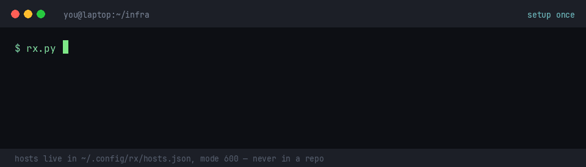

# remote-exec

<h3 align="center">SSH from an agent that cannot hang on a password prompt.</h3>

<p align="center">
  <a href="LICENSE"></a>
  
  
  
</p>

<p align="center">
  
</p>

## Install

One command for each agent — the skill is plain Markdown plus a script, so nothing is coupled to one ecosystem.

```bash
# Claude Code (plugin, stays updatable)
claude plugin marketplace add ibrahimbdr/appit-skills
claude plugin install remote-exec@appit-skills

# pi
pi install git:github.com/ibrahimbdr/remote-exec

# any agent that reads a skills directory
git clone git@github.com:ibrahimbdr/remote-exec.git
cp -r remote-exec/skills/remote-exec ~/.claude/skills/      # or ~/.codex/skills/, .cursor/skills/, …
```

## Why this exists

Agent SSH fails in three predictable ways: it blocks on a prompt, it mangles quoting, or it starts something long-lived and never returns. This removes all three, and replaces five round trips with one `probe`.

## Use

- Register a host: `scripts/rx.py add stage deploy@10.0.0.5:2222`
- Health in one call: `scripts/rx.py probe stage` — uptime, >70% disks, memory, containers, GPU, ports`
- Run / logs / copy: `run` · `logs` · `put` · `get`, all with `--timeout`

## Requires

- `ssh` client and key-based auth (password auth cannot work, by design).
- Optional hosts file via `rx.py add`, mode 600, outside any repo.
- Python 3.9+ (stdlib only).

## What you get

- BatchMode + ConnectTimeout: a dead host fails in ~8 s instead of blocking the session.
- `probe` deliberately ignores `/snap` mounts so disk pressure is signal, not noise.
- Destructive remote commands are documented as require-explicit-go-ahead.

## Cost

| | tokens |
| --- | --- |
| always-on (the description, every session) | ~80 |
| on invoke | ~0.9k |

The demo above is regenerated from a real run: `demos/remote-exec.json` holds the captured
output, `tools/make_demo.py` renders it. No invented screenshots.

## Security

Static analysis with SkillSpector: **0/100, SAFE, 0 open findings** against the committed
baseline. Every accepted finding is listed with its reason in [SECURITY.md](SECURITY.md).
The skill never uses `shell=True`, never reads or stores a credential, and never chooses a
network destination at runtime.

## Part of the Appit collection

Browser QA · CI triage · Postgres · runbooks · SSH · Trello · cloud browsers · OpenDesign · Blender —
one marketplace: [appit-skills](https://github.com/ibrahimbdr/appit-skills).

## License

MIT. See [LICENSE](LICENSE).
